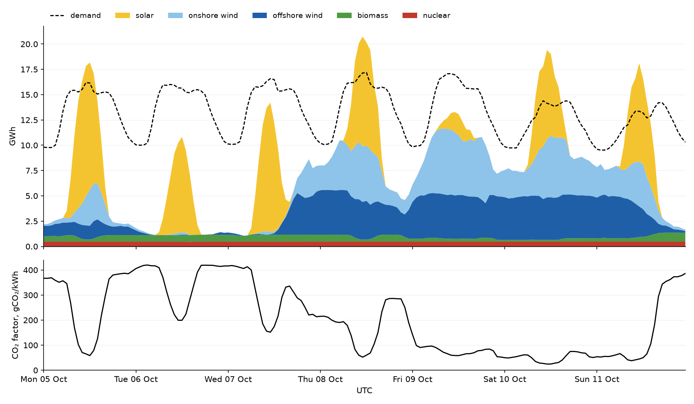
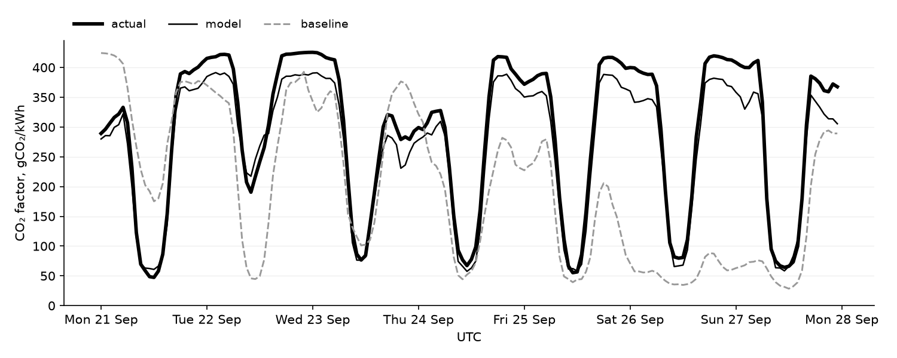
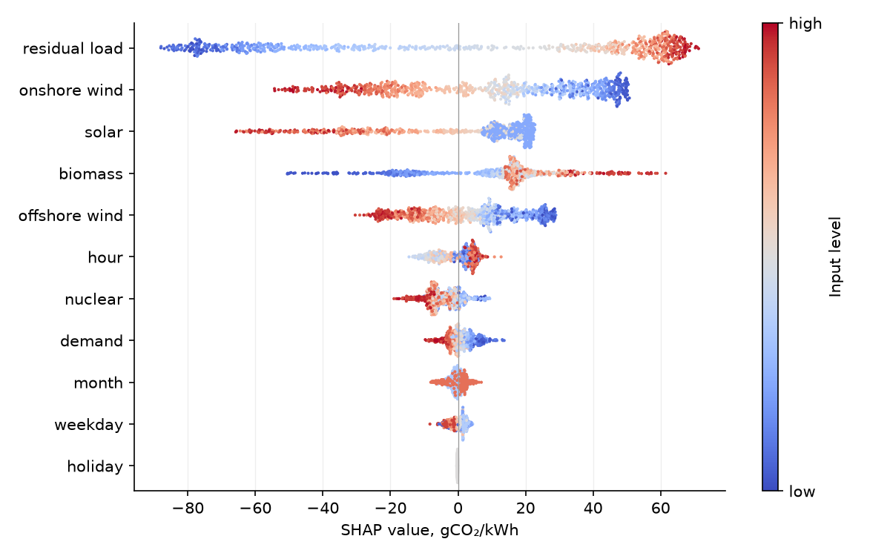
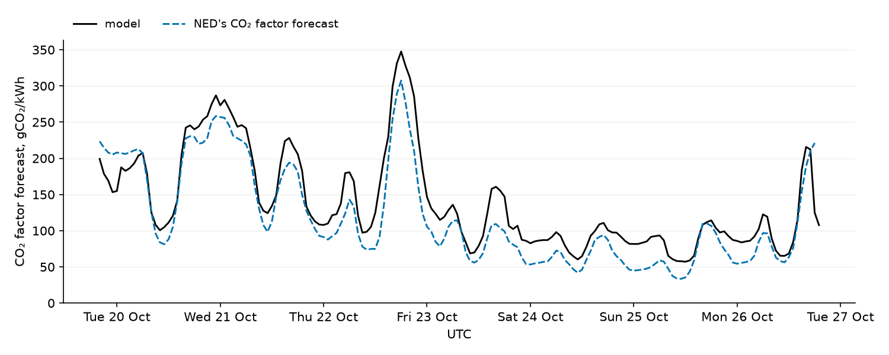
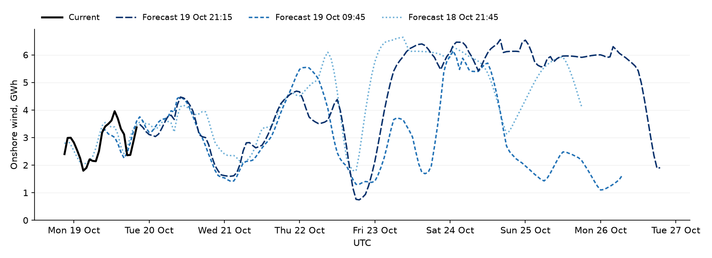

# Week-ahead CO₂ factor forecast

## Summary

### The forecast

- The CO₂ factor of Dutch electricity production for the next 168 hours, one value per hour, from one command.
- It is based on:
  - NED's Forecast of solar, wind, nuclear, biomass co-firing and demand for those hours
  - one LightGBM model that maps these inputs to the CO₂ factor, retrained on the 12 months of NED history before each run
- With perfect input forecasts, on the test weeks, in gCO₂/kWh:
  - average CO₂ factor: 264
  - model mean absolute error (MAE): 23, or 9% of the average
  - MAE of repeating the last available week: 111, or 42% of the average

### Testing

- I chose the model on forecasts made from 25 July to 21 August 2026 and tested it on forecasts made from 7 September to 4 October 2026.
- The test uses NED's Current, its estimate of actual volumes, in place of input forecasts.

## Approach

### NED's CO₂ formula

- NED returns an `emissionfactor` with each of its 10 generation series, not only with the total. In the history, these factors are constant per technology, in kg/kWh:
  - gas: 0.396
  - coal: 0.798
  - CHP: 0.298
  - waste: 0.22
  - other series: 0
- This suggested that the published CO₂ factor is their mean weighted by generation:

  CO₂ factor = 1000 × Σ volumeᵢ × emissionfactorᵢ / total generation

- I checked it once on all 10 series, September 2024 – October 2026. The median difference from the published value is 0.02%.
- Three consequences:
  - Fossil generation cannot be a model input. Its forecasts plus this formula would give the CO₂ factor without a model, and NED publishes such a forecast itself.
  - I want a model that needs only renewable and demand forecasts, not a rebuild of NED's own CO₂ forecast. So I measure it against the weekly baseline and a linear regression, and use NED's forecast only as a sanity check.
  - The model has to learn how much demand is left for fossil plants after solar and wind. So besides renewables I add demand, residual load and the calendar.

### Inputs

For each target hour, the model sees only that hour's values:

- solar, onshore and offshore wind, nuclear, biomass co-firing and demand
- residual load: demand minus solar and wind, which trees cannot easily build from four separate inputs
- the Amsterdam calendar: hour, weekday, month and a Dutch holiday flag

The CO₂ factor's own history is not an input, because the model should learn how renewable generation and demand drive the CO₂ factor, not repeat its past values.

- The chart shows the five generation inputs stacked against demand, with the CO₂ factor below, as hourly Current values for 5–11 October 2026.
- The CO₂ factor is low when the stack reaches demand and high when a gap remains for fossil plants.

### Model

LightGBM with squared error loss, retrained on the 12 months before each run.

- The CO₂ factor rises with residual load nonlinearly. Gradient boosting fits this and the calendar effects.
- It trains on a year of hourly rows in seconds.
- I compared five configurations on validation and chose the most regularized one, which had the lowest MAE. Its parameters are in `co2_forecast/model.py`.
- Other training windows changed the validation error by less than 3%, so I kept 12 months.
- Linear (ridge) regression on the same inputs has about 70% higher MAE than LightGBM.

## Evaluation

### Protocol

- Gaps: hours with missing NED data, such as 22–23 August 2026, are excluded from training and evaluation.
- Periods, by forecast start (origin):
  - validation: every hour from 25 July to 21 August 2026
  - test: every hour from 7 September to 4 October 2026
- Retraining: on the first day of every month, on the preceding 12 months with a one-hour availability buffer.
- Model selection: on validation only.
- Inputs: NED's Current, its estimate of actual volumes. NED's API keeps only the latest version of a past forecast, so the forecasts made at that time are not available.
- Baseline: each target hour repeats the CO₂ factor one week earlier. If that hour is not yet published when the forecast starts or is missing, it takes the last available hour before it.
- Metrics, in gCO₂/kWh, with every origin and target hour weighted equally:
  - mean absolute error (MAE): the main criterion
  - root mean squared error (RMSE): sensitive to large misses
  - mean error: forecast minus actual, negative when the model under-forecasts

### Results

Metrics in gCO₂/kWh:

- Test:
  - model: MAE 23.0, RMSE 28.3, mean error −19.2
  - linear regression: MAE 38.6, RMSE 44.5, mean error −27.1
  - baseline: MAE 110.5, RMSE 139.0
- Validation:
  - model: MAE 17.8, RMSE 23.4, mean error +11.1
  - linear regression: MAE 31.7, RMSE 39.4, mean error +23.7
  - baseline: MAE 56.6, RMSE 76.0

- The chart shows one test week with actual inputs.
- The model follows the daily solar dips and the multi-day wind periods that the baseline misses.
- Most of the remaining error is a level shift, as the mean error shows. The model under-forecasts on the autumn test and over-forecasts on the summer validation. The linear regression shifts the same way, so the shift does not come from boosting.
- The model does not see fuel and CO₂ prices or temperature. Prices decide whether gas or coal covers the residual load, and cold weather keeps CHP plants running for heat, so either may cause the shift.

### Feature importance

- Residual load has the largest effect, followed by wind, solar and biomass. The calendar, nuclear and demand matter little.
- Residual load dominates because it measures the demand left for fossil plants.
- NED's biomass series is biomass burned in coal plants, so a high value means coal plants are running.

- Each point is one test hour, and its colour is the input's level. High wind and solar lower the CO₂ factor, and high residual load and biomass raise it.
- Wind, solar and demand also enter residual load, so SHAP splits one effect between them. This is why high demand shows a small negative value.

## Live forecast

- The run from 19 October 2026, 20:00 UTC, shows the whole pipeline on NED's live Forecast. Its shape follows NED's own CO₂ factor forecast, with correlation 0.95.

## Assumptions and limitations

- The metrics assume perfect input forecasts. The real error adds the error of NED's Forecast, which grows with the horizon.
- The model learns from actual volumes and never sees forecast errors.
- The four test weeks cover one autumn. NED also revises its history, and the evaluation uses the values as downloaded.
- The last one to three forecast hours repeat the previous day, because NED's Forecast ends early or with a partial hour.
- NED revises its Forecast within hours. In two snapshots taken about a day apart, on 18–19 October 2026, the same target hours changed on average by 7–25% for wind and solar, 1% for demand and 19% for NED's own CO₂ factor forecast.
- The chart shows three onshore wind snapshots with Current for the hours already passed. They agree for the first day and diverge later.

## Next steps

- Evaluate on real forecasts. NED's API keeps only the latest Forecast, so this needs an archive of Forecast snapshots collected over a few weeks. It would give true week-ahead metrics by horizon.
- With such an archive, train on the forecasts themselves, so the model learns how much to trust them at each horizon.
- Try fuel prices, temperature and cross-border flows as inputs, to see if they fix the level shift.
- Predict quantiles instead of one value, when over- and under-forecasts cost differently.
